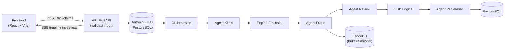

# J-ARI — Pusat Pemeriksaan Klaim (AEGIS)

Sistem pemeriksaan klaim JKN berbasis **pipeline multi-agent**: klaim masuk antrean
FIFO, diproses berurutan oleh agent, lalu die-ranking sehingga verifier dapat menangani
klaim yang paling merugikan. Backend FastAPI + PostgreSQL + LanceDB, frontend
React (Vite), model biaya XGBoost + Isolation Forest, penjelasan SHAP, dan narasi LLM.

Proyek ini memakai **data sintetis saja** — bukan validasi kinerja BPJS dan
tanpa data peserta JKN asli. Keputusan akhir selalu di tangan verifier manusia;
LLM tidak pernah mengubah skor, tier, atau bukti.


---

## Daftar Isi

- [Fitur](#fitur)
- [Menjalankan Aplikasi](#menjalankan-aplikasi)
- [Cara Kerja](#cara-kerja)
- [Skor Risiko dan Tier](#skor-risiko-dan-tier)
- [Database Demo](#database-demo)
- [Struktur Proyek](#struktur-proyek)
- [Pengujian](#pengujian)
- [Contoh Output](#contoh-output)
- [Dokumentasi](#dokumentasi)
- [Batasan](#batasan)

---

## Fitur

- **Pipeline per-klaim** di antrean FIFO: Validasi → Klinis → Finansial → Fraud →
  Review → Risiko → Penjelasan; tiap tahap menyimpan hasil dan alasannya.
- **Skor risiko mentah 0–85** (bukan probabilitas): klinis ≤20 + finansial ≤30 +
  relasional ≤20 + bukti ≤15.
- **Tier terkalibrasi**: medium ≥ 48,7 · high ≥ 55,0, plus lantai relasional
  (exact-duplicate → High; repeat/cloning/unbundling kuat → Medium).
- **Investigasi real-time** via Server-Sent Events: timeline tahap per klaim di UI.
- **Penjelasan bukti**: SHAP untuk kontribusi model biaya, bukti relasional di
  LanceDB, dan narasi LLM dengan cascade Gemini → Ollama → template deterministik.
- **Keputusan manusia tercatat**: pilihan verifier (setuju/override) tersimpan di
  `human_decisions` + `audit_logs`.
- **Tooling demo**: `dry-run` offline, reset database demo, dan seed 220 klaim
  curated lewat alur produksi REST (tanpa tulis tabel langsung).
- **334 unit test backend** untuk risk engine, agent pipeline, evaluasi model, dan API.

## Menjalankan Aplikasi

**Prasyarat:** Windows 10/11 · Python 3.10+ · PostgreSQL 16 · Node.js 20.19+ · Git.

Dari direktori proyek (ganti `<password-lokal>` dengan password PostgreSQL Anda):

### 1) Konfigurasi

```bat
git clone https://github.com/Catalna/aegis-health.git
cd aegis-health
copy .env.example .env
```

Isi `DATABASE_URL` pada `.env`:

```
DATABASE_URL=postgresql+asyncpg://postgres:<password-lokal>@localhost:5432/jari_db
```

### 2) Buat database

```bat
psql -U postgres -c "CREATE DATABASE jari_db;"
```

Skema tabel dibuat otomatis saat backend pertama kali berjalan.

### 3) Dependensi backend dan frontend

```bat
python -m venv venv
venv\Scripts\python.exe -m pip install -r backend\requirements.txt
cd frontend
npm ci
cd ..
```

### 4) Model runtime

Backend membutuhkan `backend/models_trained/xgboost_regressor.json` dan
`isolation_forest.pkl` (folder ini gitignored). Jika belum ada:

```bat
venv\Scripts\python.exe scripts\train_all.py
```

### 5) Jalankan

```bat
start.bat
```

Dua jendela CMD terbuka: backend (uvicorn :8000, reload) dan frontend (vite :5173).

### 6) Verifikasi

```bat
curl http://localhost:8000/api/health
```

Yang menentukan: komponen `database`, `queue_worker`, `vector_store`, `ml_*`.
UI di `http://localhost:5173`.

### 7) Menghentikan

Tekan `Ctrl+C` di jendela backend dan frontend (atau tutup kedua jendela CMD).

## Cara Kerja



1. **Frontend** mengirim klaim ke `POST /api/claims`; masukan `ClaimInput` divalidasi lebih dulu.
2. **Queue worker** mengambil klaim berikutnya dari antrean FIFO dan memanggil **orchestrator**.
3. **Agent klinis** menandai deviasi indikasi, rujukan, dan lama rawat.
4. **Engine finansial** membandingkan nilai tagih dengan prediksi biaya (XGBoost + Isolation Forest); deviasi menjadi dasar sub-skala finansial.
5. **Agent fraud** menggali pola relasional (repeat, pembagian, cloning, duplikat) terhadap riwayat klaim; bukti disimpan ke **LanceDB**.
6. **Agent review** merangkum temuan berbahaya sebelum skor akhir.
7. **Risk engine** menjumlahkan sub-skala menjadi skor 0–85, menerapkan lantai relasional, lalu memetakan tier.
8. **Agent penjelasan** menyusun kontribusi SHAP dan narasi LLM (cascade Gemini → Ollama → template); timeline tahap dikirim ke UI via **SSE**.
9. **Verifier manusia** mengambil keputusan akhir — tercatat di `human_decisions` + `audit_logs`.

### Modul Utama

| File | Tanggung jawab |
| --- | --- |
| `backend/app/api/main.py` | Endpoint REST, SSE, health, dan evaluasi ML. |
| `backend/app/agents/orchestrator.py` | Urutan agent per klaim dan penyimpanan hasil tiap tahap. |
| `backend/app/agents/clinical_agent.py` | Deviasi klinis: indikasi, rujukan, lama rawat. |
| `backend/app/agents/financial_engine.py` | Prediksi biaya vs nilai tagihan (XGBoost + Isolation Forest). |
| `backend/app/agents/fraud_agent.py` | Flag relasional dan pengumpulan bukti ke LanceDB. |
| `backend/app/agents/review_agent.py` | Rekap temuan berbahaya sebelum skor akhir. |
| `backend/app/agents/risk_engine.py` | Sub-skala → skor 0–85 → tier dengan lantai relasional. |
| `backend/app/agents/explanation_agent.py` | Kontribusi SHAP + narasi LLM (cascade provider). |
| `backend/app/ml/` | Fitur, similarity scoring, dan metrik grafik fasilitas. |

## Skor Risiko dan Tier

| Sub-skala | Bobot maks | Dasar penilaian |
| --- | --- | --- |
| Klinis | ≤ 20 | Deviasi indikasi, rujukan, lama rawat. |
| Finansial | ≤ 30 | Deviasi nilai tagihan terhadap prediksi biaya. |
| Relasional | ≤ 20 | Flag repeat, pembagian, cloning, duplikat. |
| Bukti | ≤ 15 | Kekuatan bukti yang terkumpul. |
| **Total** | **85** | Skor mentah, bukan probabilitas. |

Tier memakai ambang terkalibrasi: **medium ≥ 48,7** dan **high ≥ 55,0**.
Lantai relasional memaksa minimal tier ketika bukti relasional kuat:

| Bukti relasional | Tier minimal |
| --- | --- |
| Duplikat eksak | High |
| Repeat / cloning / unbundling kuat | Medium |

## Database Demo

Database demonstrator diisi 220 klaim sintetis curated: **90 normal + 130 anomali**
dari 10 keluarga skenario (unbundling, repeat, cloning, upcoding, phantom,
inflated, prolonged-LOS, duplikat eksak, pasangan lintas-batas-45-hari, dan
pendamping). Seeding **hanya lewat alur produksi REST** — POST ke API → worker →
orchestrator → LanceDB; tidak ada penulisan tabel langsung.

```bat
:: cek desain offline tanpa server (hasil: 220/220 sesuai target)
venv\Scripts\python.exe scripts\demo_seed.py --dry-run

:: KOSONGKAN database demo + vector store (hanya untuk data demo sintetis)
venv\Scripts\python.exe scripts\demo_reset.py --yes

:: seed 220 klaim via REST (pertama ~20-40 menit)
venv\Scripts\python.exe scripts\demo_seed.py
```

## Struktur Proyek

```text
aegis-health/
├── backend/
│   ├── app/agents/          # Orchestrator + agent pipeline
│   ├── app/api/             # Endpoint REST, SSE, health
│   ├── app/ml/              # Model biaya, fitur, similarity scoring
│   ├── app/models/          # ORM + pembuatan skema PostgreSQL
│   ├── models_trained/      # Artefak model runtime (gitignored)
│   └── tests/               # Unit test (334 passed, 2 skipped)
├── frontend/                # React (Vite): dashboard, daftar klaim, investigasi
├── scripts/                 # train_all, demo_seed, demo_reset, evaluasi
├── docs/                    # PRD, arsitektur, runbook demo, laporan evaluasi
├── .env.example             # Template konfigurasi lokal
├── pytest.ini
├── start.bat                # Launcher backend + frontend (dua jendela CMD)
└── README.md
```

## Pengujian

```bat
venv\Scripts\python.exe -m pytest backend\tests -q
```

Cakupan pengujian:

- Risk engine: sub-skala, skor 0–85, ambang tier, dan lantai relasional.
- Pipeline agent: setiap agent dan orchestrator menyimpan hasil tiap tahap.
- API, antrean worker, dan endpoint SSE.
- Evaluasi model dari artefak training riil (`models_trained/`).

Hasil saat ini (dengan Python 3.10.11 lokal):

```text
334 passed, 2 skipped
```

## Contoh Output

Health endpoint `GET /api/health` (format disederhanakan):

```json
{
  "status": "ok",
  "components": {
    "database": { "status": "ok" },
    "queue_worker": { "status": "ok", "detail": "Antrean pemeriksaan aktif" },
    "vector_store": { "status": "ok" },
    "ml_cost_model": { "status": "ok" }
  }
}
```

Ringkasan siklus demo terverifikasi 2026-10-24 (format disederhanakan):

```text
dry-run    : hasil: 220/220 sesuai target; peringatan flag di luar desain: bersih
submit     : ok 220, skip 0, err 0
drain      : failed 0
tier       : high 4 / medium 86 / low 130
status     : processed 130 / review_required 90
exposure   : Rp 462.306.032
```

## Dokumentasi

Dokumentasi produk, arsitektur, dan evaluasi tersedia di folder `docs/`:

- [`PRD.md`](docs/PRD.md) — kebutuhan produk dan acceptance criteria.
- [`Architecture.md`](docs/Architecture.md) — komponen backend/frontend dan skema database.
- [`BusinessCore.md`](docs/BusinessCore.md) — domain JKN, tier, dan alur kerja verifier.
- [`DEMO_RUNBOOK.md`](docs/DEMO_RUNBOOK.md) — menyiapkan dan merekam demo (storyboard 8 menit).
- [`EVALUATION_REPORT.md`](docs/EVALUATION_REPORT.md), [`RUNTIME_EVALUATION.md`](docs/RUNTIME_EVALUATION.md),
  [`TIER_CALIBRATION.md`](docs/TIER_CALIBRATION.md) — metrik evaluasi kandidat (disclaimer synthetic demonstrator selalu menyertai).
- [`MODELS.md`](docs/MODELS.md) — kontrak artefak model dan prosedur promosi.
- [`DECISIONS.md`](docs/DECISIONS.md) — keputusan engineering (termasuk aturan privasi LLM).

Riwayat perubahan ada di [`CHANGELOG-agent.md`](docs/CHANGELOG-agent.md); arsip spesifikasi
dan rencana implementasi ada di `docs/specs/` dan `docs/plans/`.

## Batasan

- **Synthetic demonstrator only**: tidak memuat atau memvalidasi data peserta JKN asli.
- LLM hanya menyusun narasi; tidak pernah mengubah skor, tier, atau bukti.
- Aturan privasi: bila memproses data di luar seed sintetis, set `LLM_PROVIDER=ollama`.
- Model runtime harus dilatih lokal (`models_trained/` tidak ikut repositori).
- Database demo bersifat presentational; ground truth evaluasi tetap laporan di `docs/`.
- Worker antrean tunggal berjalan sekuensial per klaim; belum ada pengaturan skala.
- Setup ditujukan untuk Windows lokal; deployment produksi berada di luar scope README.

