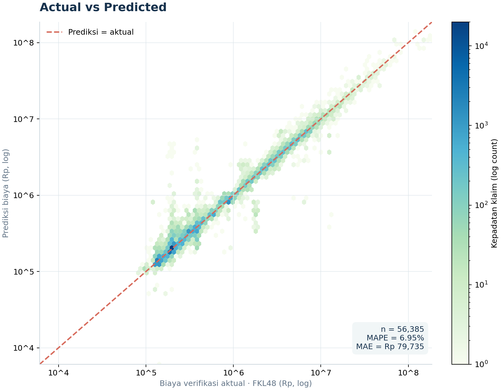
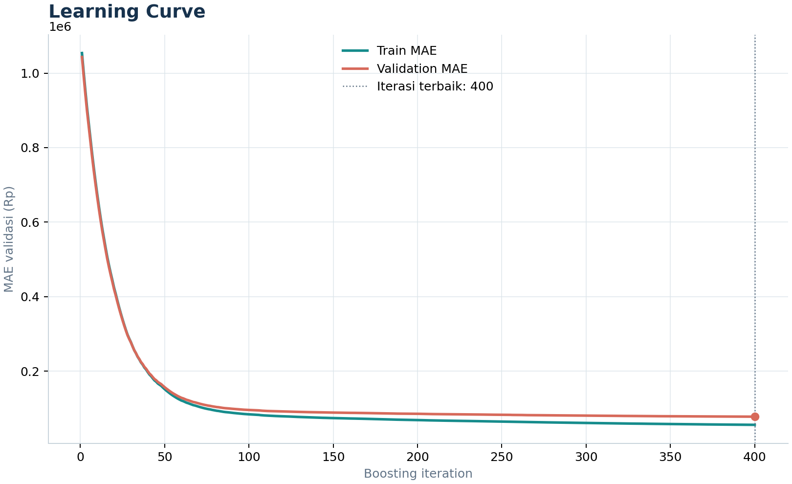
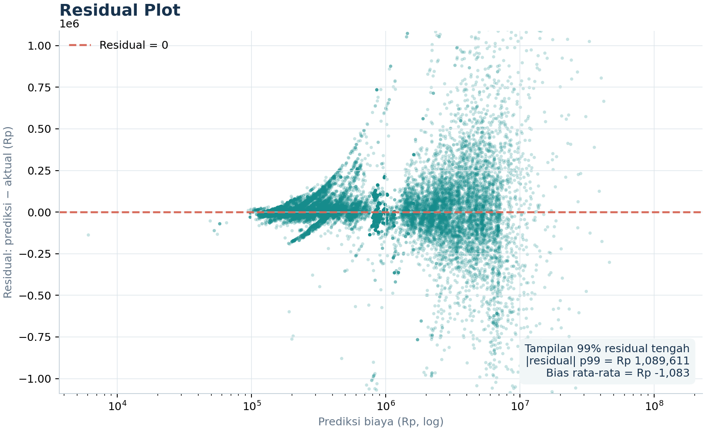
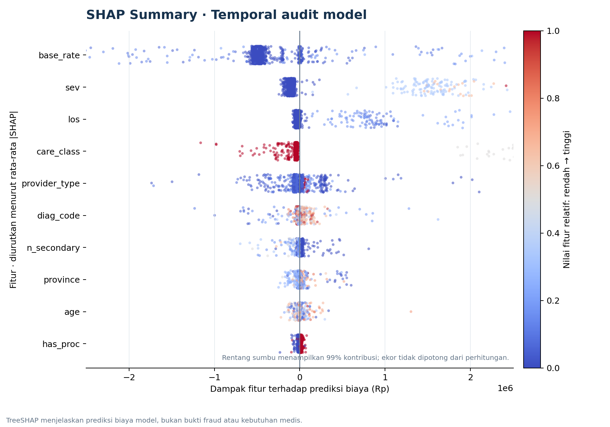

# Visualisasi Model Biaya BPJS — Audit Temporal

**Model:** XGBoost Regressor temporal dengan baseline tarif, kandidat offline. **Test:** 56.385 klaim layanan 1 Nov–31 Des 2024; peserta test terpisah dari fit/validasi. **Target:** biaya verifikasi `FKL48` pada klaim diterima penuh.

> Grafik ini mengevaluasi estimasi biaya model. Model bukan penentu kewajaran klinis, bukan penilai kemampuan bayar pasien, dan bukan detektor fraud tervalidasi.

## 1. Actual vs Predicted

Titik hexagonal menunjukkan kepadatan klaim pada sumbu logaritmik. Garis putus-putus adalah prediksi sempurna. Model test: MAPE 6,95%, MAE Rp79.735.

## 2. Learning Curve

MAE fit dan validasi terhadap boosting round. Error validasi masih menurun pada iterasi ke-400, batas maksimum eksperimen; jadi kurva belum menunjukkan plateau yang meyakinkan. Jangan menafsirkan perpotongan/selisih kecil train-validasi sebagai bukti generalisasi eksternal.

## 3. Residual Plot

Residual = prediksi − aktual; positif berarti prediksi lebih tinggi. Rentang vertikal menampilkan 99% residual tengah agar pola utama terbaca; ekor tetap masuk dalam metrik keseluruhan. Pelebaran sebaran pada prediksi tinggi menunjukkan error heteroskedastik dan perlunya perhatian pada klaim mahal.

## 4. SHAP Summary

TreeSHAP dihitung pada sampel 1.200 klaim test dan kontribusinya diverifikasi agar jumlah SHAP + bias sama dengan prediksi model. Sumbu x adalah kontribusi terhadap prediksi rupiah; warna adalah nilai fitur relatif rendah-ke-tinggi dalam sampel. Tampilan sumbu membatasi ekor 1% untuk keterbacaan, bukan menghapusnya dari perhitungan SHAP.

Baseline tarif mendominasi kontribusi, disusul severitas dan LOS. SHAP menjelaskan bagaimana model membentuk prediksi, **bukan** mengapa perawatan secara klinis diperlukan atau apakah klaim fraud.

## File dan reproduksi

- Folder visual aktif: `docs/figures/cost_temporal/` — empat PNG `cost_temporal_*.png`.
- Generator: `scripts/bpjs/plot_cost_temporal_audit.py`.
- Model serta kurva training: `backend/app/data/analysis/cost_temporal_audit/` (artefak lokal ter-ignasi).
- Laporan evaluasi eksperimen: [`BPJS_COST_TEMPORAL_AUDIT_REPORT.md`](BPJS_COST_TEMPORAL_AUDIT_REPORT.md).
