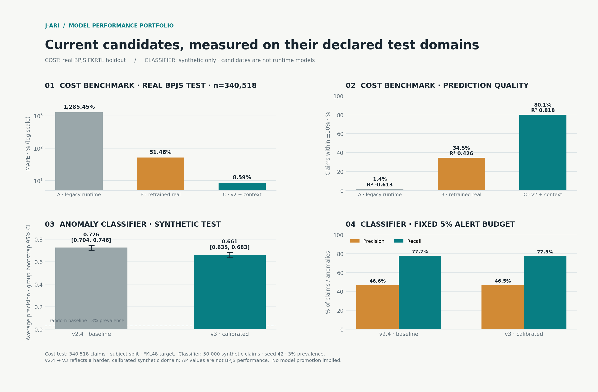

# Retraining benchmark biaya pada data riil — FKRTL BPJS Reguler 2025

**Status:** hasil ukur dari sampel (bukan target) • **Dibuat:** 2026-10-26 • **Skrip:** `scripts/bpjs/retrain_cost_benchmark.py`
**Artefak (ter-ignasi, `backend/app/data/analysis/`):** `retrain_results.json`, `base_rate_trainonly.csv`, `models/xgboost_cost_real_{legacy_b,v2_c}.json` (+ `*_features.json`)
**Disiplin:** OFFLINE ONLY — tidak menyentuh skoring runtime (freeze sampai 1 Nov); promosi hanya melalui gate A3 sesuai `docs/MODELS.md` §2.6. Tanpa PII di artefak.

Visualisasi lintas-model terbaru (biaya riil A/B/C + klasifier sintetis v2.4/v3):

## 1. Desain eksperimen

- **Populasi:** FKRTL 2023-07-15 … 2024-12-31, subset wajar `FKL47 == FKL48` & `> 0` → 1.697.588 klaim (99,90% dari 1.699.219).
- **Split:** subject-based — `crc32(PSTV01) % 10 ∈ {8,9}` = test → **train/fit 1.221.363 + holdout internal 135.707 + test 340.518**; satu peserta tidak pernah melintasi train→test. Early stop memakai holdout internal (test dibaca sekali di akhir).
- **Ground truth:** `FKL48` (nilai terverifikasi BPJS). Model dilatih pada klaim yang diterima penuh — konsisten dengan cara kerja benchmark runtime.
- **Provenance fitur (kontrak v2, C):** riil = jumlah dx sekunder (join `202405`), severitas (FKL23), LOS, diagnos primer (FKL15A), tipe faskes (FKL09), kelas rawat (FKL13), region (FKL05_NEW → 6 bucket), umur (join kepesertaan), ada-prosedur/surgical (FKL30 terisi), `ina_cbg_base_rate` = **median train-only** per (INACBG × severitas) [878 sel; unseen → median nasional train Rp 198.900]. Konstanta-gap terekplisit: `num_medications=0`, `icu=0`, `ventilator=0`. Proxy terdokumentasi: `outpatient = LOS==0`.
- Encoder diagnosis memakai katalog resmi kontrak masing-masing (legacy 10 kode; v2 katalog 159 kode) — mayoritas kode riil memang tidak berada di katalog sintetis dan ter-encode 0. Ini fakta kontrak, bukan bug.

## 2. Hasil utama (test 340.518 klaim — sama untuk semua varian)

| Varian | MAPE | medAPE | MAE | R² | within ±10% |
|---|---:|---:|---:|---:|---:|
| **A. Model runtime aktif (kontrak legacy, latihan sintetis)** | **1285,5%** | 1619,6% | Rp 3.003.648 | **−0,613** | 1,4% |
| B. Kontrak legacy, dilatih ulang di riil | 51,5% | 32,0% | Rp 461.574 | 0,426 | 34,5% |
| **C. Kontrak v2 + konteks, dilatih ulang di riil** | **8,59%** | **3,42%** | **Rp 121.822** | **0,8184** | **80,1%** |

Tiga pembacaan:

1. **Degradasi model runtime aktif terkonfirmasi secara kuantitatif.** Pada data riil, model legacy sintetis menghasilkan MAPE >12× dan R² negatif (lebih buruk dari rata-rata) — hanya 1,4% klaim masuk band ±10%. Ini *bukan* bug kode; ini distribusi: peer baseline sintetis, rentang LOS sintetis, dan katalog diagnosis 10-kode tidak mengenal dunia riil INACBG (899 kode; dominasi hemodialisis). Peringatan `docs/MODELS.md` §2.6 ("file swap berarti benchmark terdegradasi diam-diam") kini terbukti dengan angka.
2. **B menunjukkan separuh masalahnya distribusi, selebihnya kontrak.** Kontrak legacy yang sama bila dilatih ulang di riil sudah turun ke MAPE 51,5% — jauh lebih baik dari A, tapi tetap lemah karena kontraknya kekurangan konteks (region/tipe/umur/tarif).
3. **C adalah kandidat benchmark biaya dari data riil:** MAPE 8,6%; medAPE 3,4%; 80,1% klaim dalam ±10%. Gain didominasi `ina_cbg_base_rate` (tabel tarif implisit) → `severity_level` → `length_of_stay` → `facility_type` → `patient_age` → `num_secondary_diags` → `facility_class` → `region`.

## 3. Kejujuran stratum (jangan membaca R² global sebagai jaminan)

| View (test) | n | Varian | MAPE | medAPE | R² |
|---|---:|---|---:|---:|---:|
| Dialisis `Q-5-44-0` | 160.068 | C | 8,17% | 1,58% | **0,102** |
| Non-dialisis | 180.450 | C | 8,96% | 4,67% | 0,817 |
| Test terbaru (≥ 2024-11-06, p85) | 51.873 | C | 8,40% | 3,40% | 0,769 |
| Dialisis | 160.068 | B | 28,27% | 7,69% | −0,008 |
| Non-dialisis | 180.450 | B | 72,08% | 53,07% | 0,405 |
| Dialisis | 160.068 | A | 1528,9% | 1670,9% | **−52,44** |

- **Dialisis:** medAPE 1,58% (prediktor sangat presisi karena harga terkunci di tarif) tetapi **R² 0,102** — hampir semua variasi nilai dalam sel sudah habis oleh tarif; R² rendah karena varians tersisa kecil dan intra-sel. Nilai R² global 0,82 adalah campuran prediksi tarif dan variasi lintas sel.
- **Stabilitas waktu:** window dua bulan terakhir tak menunjukkan drift (MAPE 8,40% vs 8,59% global).
- Regresi ini memprediksi **biaya wajar (tarif)** — nilainya justru ketika klaim **melenceng dari tabel tarifnya**; itu domain tabel peer baseline (`docs/BPJS_PEER_BASELINE.md`) dan sinyal deviasi, bukan protokol klinis.

## 4. Pemeriksaan kondisi gate A3 (MODELS.md §2.6: 9 input hilang)

| Input v2 yang hilang di runtime | Kini tersedia dari data riil? | Catatan |
|---|---|---|
| `patient_age` | ✔ riil (join kepesertaan; 100% terisi di KLTK→umur) | jalur J1/J3 di A1 |
| `outpatient` | ✔ proxy LOS==0 | dokumentasi wajib |
| `surgical_indicator` | ✔ proxy FKL30 presence | — |
| `facility_type` | ✔ FKL09 (encoding numeric) | mapping kontras di `*_features.json` |
| `facility_class` | ✔ FKL13 (kelas rawat) | semantic kelas rawat vs kelas RS perlu catatan |
| `region` | ✔ FKL05_NEW → 6 bucket | — |
| `regional_base_rate` | ✔ tabel train-only → produksi = tabel peer `peer_baseline_reguler_*` | butuh kontrak lookup runtime |
| `icu_indicator` | ✗ konstanta 0 (gap) | jalur A1 payload E-Klaim |
| `ventilator_used` | ✗ konstanta 0 (gap) | jalur A1 payload E-Klaim |

**7 dari 9 input tersedia secara riil**; ICU & ventilator resmi jadi gap terdeklarasi (berkaitan dengan `docs/BPJS_SAMPLE_PROFILING.md` §6 item 3).

## 5. Langkah lanjut (semua target, pasca-1-Nov)

1. Promosikan tabel `peer_baseline_reguler_*` sebagai sumber `regional_base_rate` live + `PEER_BASELINE` sintetis deprecate.
2. Ablation di runtime: C (retrained real) vs model aktif — evaluasi wajib dilaporkan per stratum: sel dialisis degeneratif, perbandingan global saja bisa menyesatkan.
3. Jika dipromosikan: kontrak fitur runtime bertambah (v2 list), threshold tier perlu re-calibrasi (band 48,7/55,0 dibangun untuk skor klasifikasi sintetis — bukan untuk regressor baru).
4. Usul model behavioral (frekuensi dialisis per peserta, multi-faskes) — kekuatan fitur behavior untuk fraud-agent, datanya SUDAH ada (PSTV01 berulang di FKTP/FKRTL) — prioritas rendah: mulai dari agregat frekuensi sederhana.

## 6. Limitasi yang harus menempel di setiap pembacaan berikutnya

- Encoder diagnosis dari katalog sintetis → banyak klaim ter-encode 0; fitur diagnosis lemah secara konstruksi (kontrak, bukan pilihan sendiri).
- `num_medications`, ICU, ventilator = konstanta 0 (bukan harga riil) — pengaruh apa pun dari kolom ini di model riil adalah artefak (bukan sinyal).
- Bobot sampel resmi BPJS (PSTV15) tidak dipakai di retraining ini — angka bias ke komposisi sampel.
- A/B/C dibangun pada klaim FKRTL-only (tanpa FKTP; benchmark biaya memang FKRTL-domain).
- Tabel base_rate train-only (878 sel) berbeda sedikit dari artefak produksi peer (898 sel, `docs/BPJS_PEER_BASELINE.md`) — produksi wajib refit penuh.
