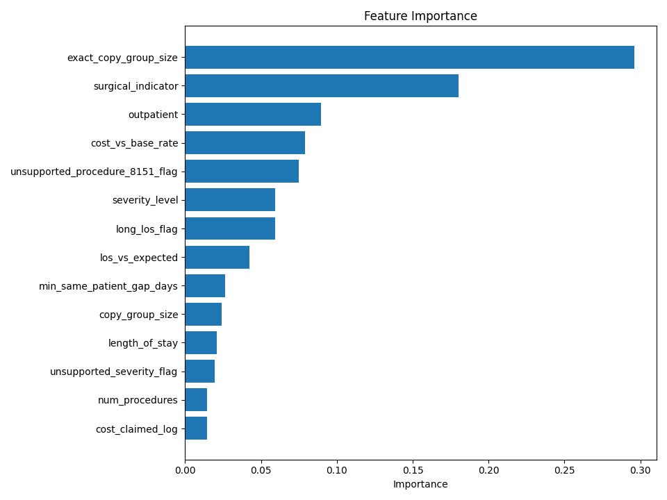
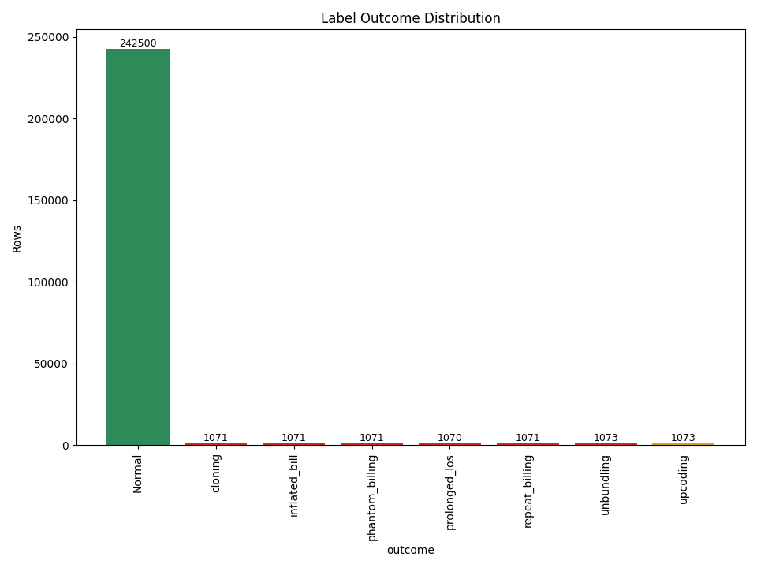
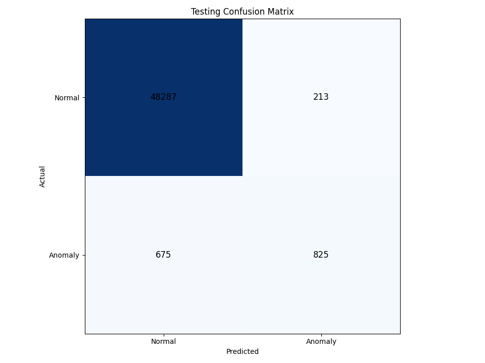
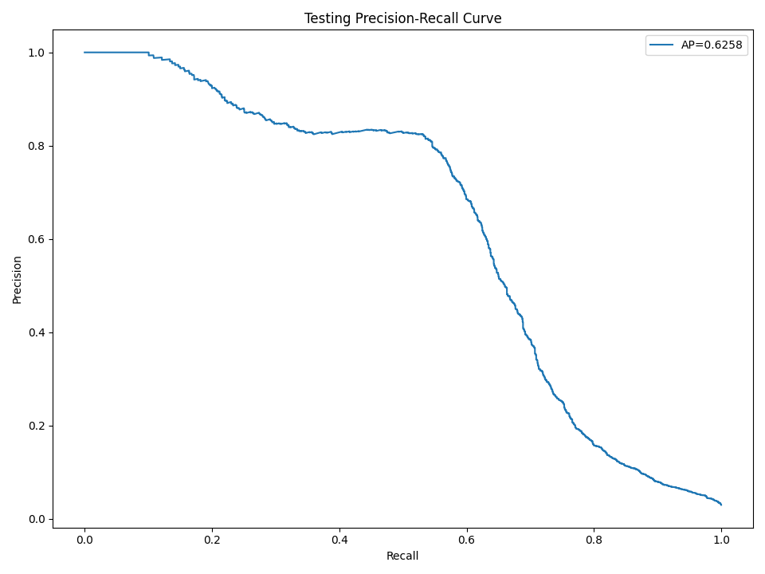
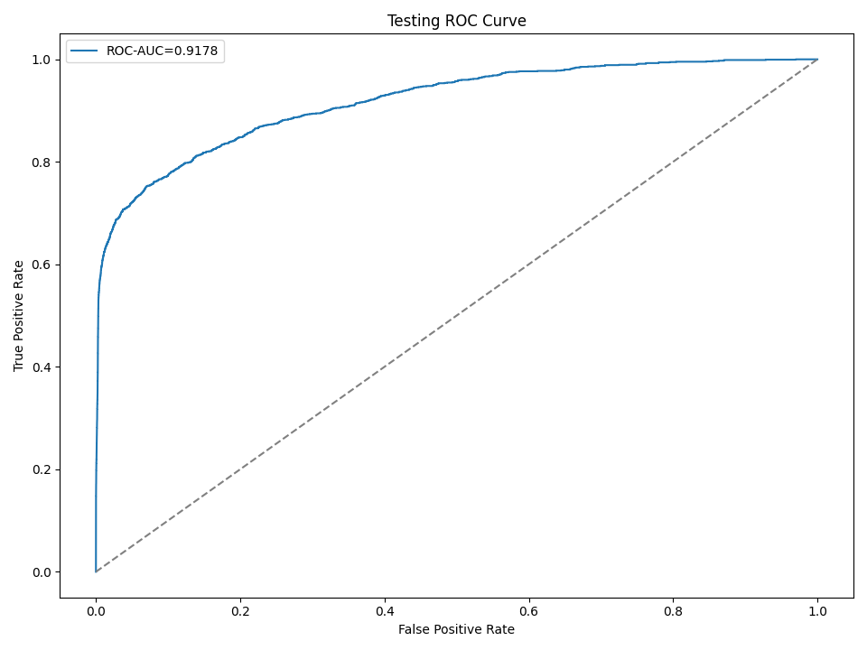
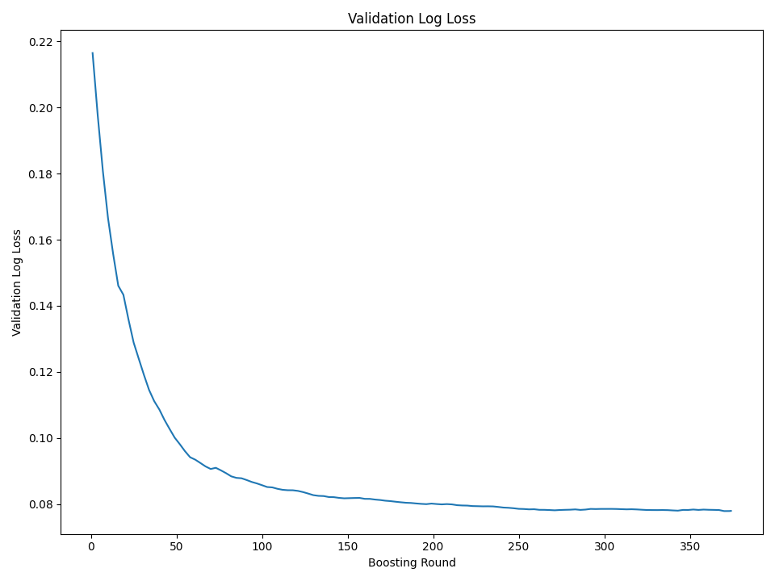

# Synthetic v2 Model Training & Evaluation

> **Synthetic demonstrator only — not BPJS performance validation.**

- Dataset version: `synthetic-v2.4.0-demonstrator`
- Train / validation / test: 150,000 / 50,000 / 50,000
- Seed: `42`
- Config SHA-256: `f088e5ff474c88ebdd1a8cbc1f012ac59dae2c38e5d09072ad0abebb1a9d04df`
- Test set was not used for feature selection or hyperparameter tuning. Aggregate AP group-bootstrap 95% CI: 0.6030–0.6520 (groups=48,437, resamples=100).

## Cost benchmark regressor

- Training rows: normal train claims only
- Validation-only selected ablation: `severity_and_base_rate`
- Test normal n: 48,500
- Test MAPE: 12.830%; MedAE: 641,852.38
- Test MAE: 863,858.85; RMSE: 1,177,733.96; R²: 0.8640
- Upper interval target coverage: 90%; measured: 90.179%

## Supervised classifier candidate (not runtime)

- Test n: 50,000; positive n: 1,500
- Average Precision: 0.6258
- ROC-AUC: 0.9178
- Baseline Average Precision:
  - random: 0.0299 (n=50,000, positives=1,500)
  - absolute_benchmark_deviation: 0.1704 (n=50,000, positives=1,500)
  - logistic_regression_rule_flags: 0.1747 (n=50,000, positives=1,500)

### Classifier configuration (selected on validation only)

- depth 5, scale_pos_weight 1: validation AP 0.5888 @ iteration 399
- depth 5, scale_pos_weight 3: validation AP 0.6153 @ iteration 374
- depth 6, scale_pos_weight 1: validation AP 0.5051 @ iteration 2
- depth 6, scale_pos_weight 3: validation AP 0.6153 @ iteration 343
- Selected: depth 5, scale_pos_weight 3, iteration 374; the test set played no part in this choice.

### Fitur paling berpengaruh (gain)

- `exact_copy_group_size`: 459
- `surgical_indicator`: 279
- `outpatient`: 139
- `cost_vs_base_rate`: 122
- `unsupported_procedure_8151_flag`: 116

### Operating point (threshold 0.5601, selected on validation)

- Accuracy: 98.2240%; Precision: 79.4798%; Recall: 55.0000%; F1: 0.6501
- Specificity: 99.5608%; Balanced accuracy: 77.2804%; MCC: 0.6528
- Brier score: 0.0166; Log loss: 0.0779; ECE: 0.0163
- Alerts: 1,038 of 50,000 (2.076%); TP=825, FP=213, TN=48,287, FN=675
- The threshold was fitted on validation only and then frozen for test; test labels never selected it.

### Natural test by anomaly type

- `cloning`: positives=214, AP=0.0610, F1=0.171
- `inflated_bill`: positives=214, AP=0.0805, F1=0.216
- `phantom_billing`: positives=214, AP=0.1041, F1=0.251
- `prolonged_los`: positives=214, AP=0.0508, F1=0.150
- `repeat_billing`: positives=214, AP=0.1753, F1=0.195
- `unbundling`: positives=215, AP=0.5731, F1=0.332
- `upcoding`: positives=215, AP=0.0156, F1=0.003

## Enriched stress evaluation

- Overall AP: 0.8462 (n=2,100, positives=1,050).
- Group-bootstrap AP 95% CI: 0.8322–0.8654 (groups=1,652).

### By anomaly type

- `cloning`: positives=150, AP=0.0999, F1=0.191; group CI 0.085–0.116
- `inflated_bill`: positives=150, AP=0.1036, F1=0.203; group CI 0.087–0.125
- `phantom_billing`: positives=150, AP=0.1306, F1=0.274; group CI 0.103–0.152
- `prolonged_los`: positives=150, AP=0.0873, F1=0.165; group CI 0.072–0.101
- `repeat_billing`: positives=150, AP=0.2333, F1=0.208; group CI 0.168–0.305
- `unbundling`: positives=150, AP=0.5335, F1=0.376; group CI 0.443–0.626
- `upcoding`: positives=150, AP=0.0624, F1=0.005; group CI 0.051–0.075

## OOD stress evaluation

- Overall AP: 0.6078 (n=5,000, positives=150).
- Group-bootstrap AP 95% CI: 0.5333–0.6763 (groups=4,836).

### By anomaly type

- `cloning`: positives=22, AP=0.0783, F1=0.182; group CI 0.041–0.155
- `inflated_bill`: positives=21, AP=0.0738, F1=0.183; group CI 0.031–0.156
- `phantom_billing`: positives=21, AP=0.1333, F1=0.283; group CI 0.089–0.224
- `prolonged_los`: positives=21, AP=0.0572, F1=0.167; group CI 0.028–0.097
- `repeat_billing`: positives=21, AP=0.1645, F1=0.150; group CI 0.044–0.317
- `unbundling`: positives=22, AP=0.5298, F1=0.364; group CI 0.308–0.742
- `upcoding`: positives=22, AP=0.0192, F1=0.000; group CI 0.012–0.033

## Figures

Figur diregenerasi dari model final seed-42 + split dataset yang sama dengan
training oleh `scripts/visualize_evaluation.py` (gaya sederhana 960×720).
Ambang keputusan seragam 0.5601 — dipilih di validation (max-F1), lalu
diterapkan apa adanya ke train/validation/test. Ini demonstrator sintetis,
bukan validasi BPJS.

### Feature Importance (gain share, 14 fitur teratas)

### Label Outcome Distribution (seluruh split, dataset sintetis v2)

### Training Confusion Matrix (ambang 0.5601)

### Validation Confusion Matrix (ambang 0.5601)

### Testing Confusion Matrix (ambang 0.5601 — identik operating point laporan)

### Testing Precision-Recall Curve

### Testing ROC Curve

### Validation Log Loss per Boosting Round

## Limitations

- Accuracy is inflated by the synthetic 3% anomaly prevalence; F1, average precision and recall are the primary balanced metrics.
- All claims and labels are synthetic; this does not validate BPJS performance.
- Test set was not used for feature or hyperparameter selection; the classifier threshold was fitted on validation only.
- Precision depends strongly on the synthetic 3% prevalence and is not an operational alert budget.
- Relational features (duplicate groups, per-patient gaps, expected-LOS benchmark) are computed per dataset split; the runtime scorer does not use them.
- Repeat-billing and cloning AP is bounded by designed legit readmission/duplicate hard negatives that share the same relational pattern.
- Grouped bootstrap intervals are single-seed; multi-seed training/evaluation is still pending.
- Natural-test per-type confidence intervals are reported via the separate enriched and OOD slices, not as natural-prevalence estimates.
