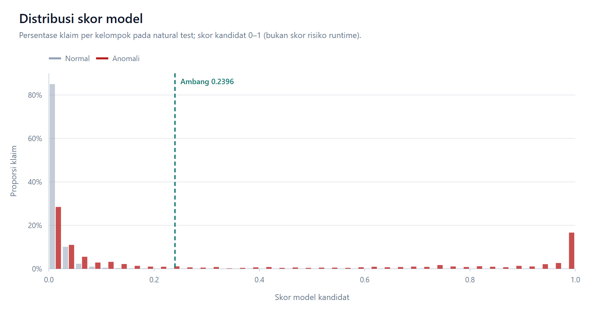
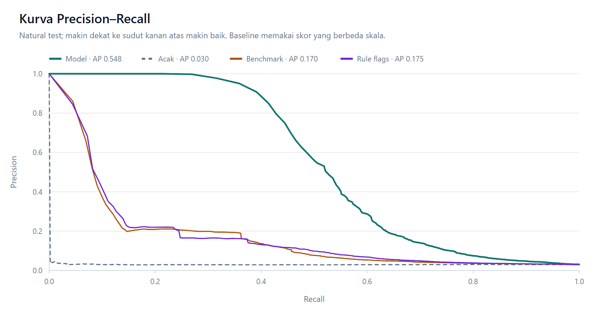
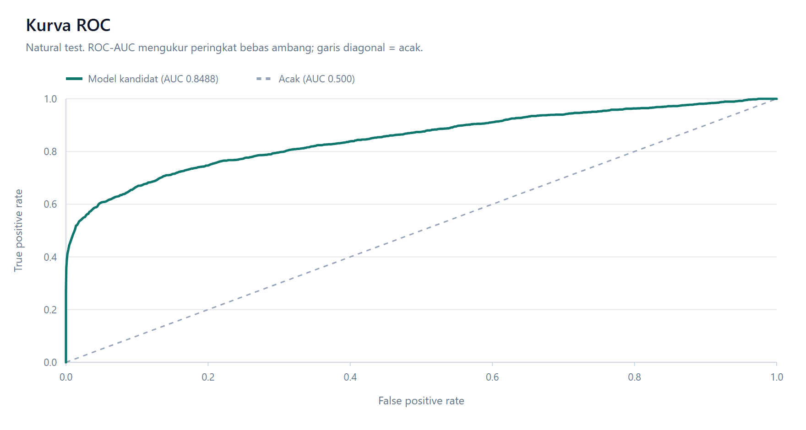
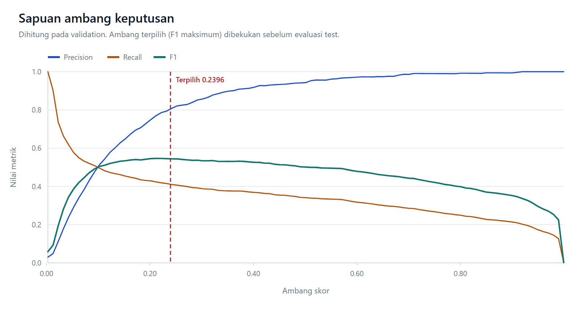
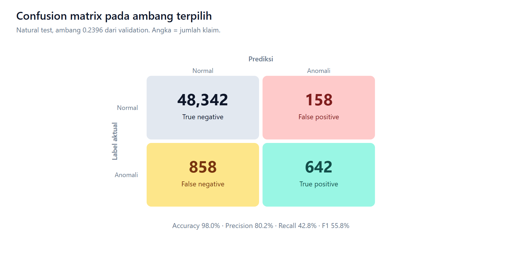
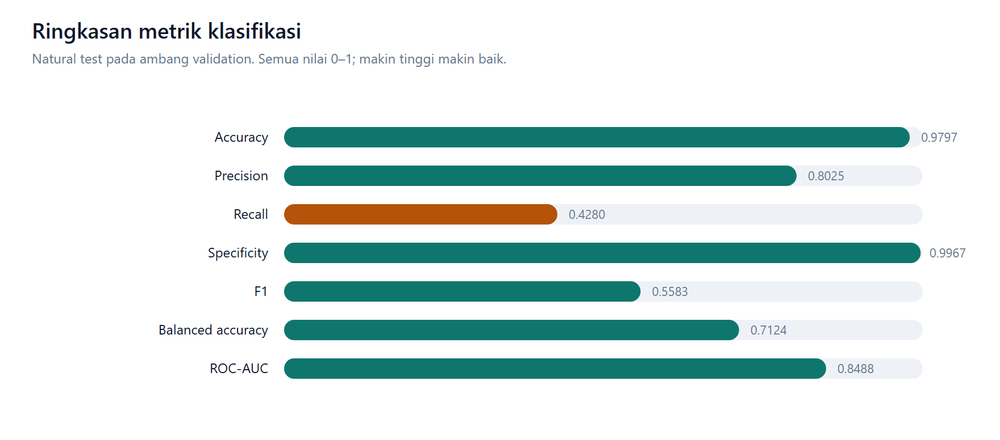
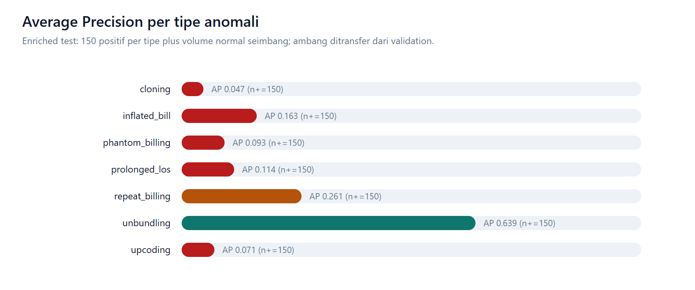
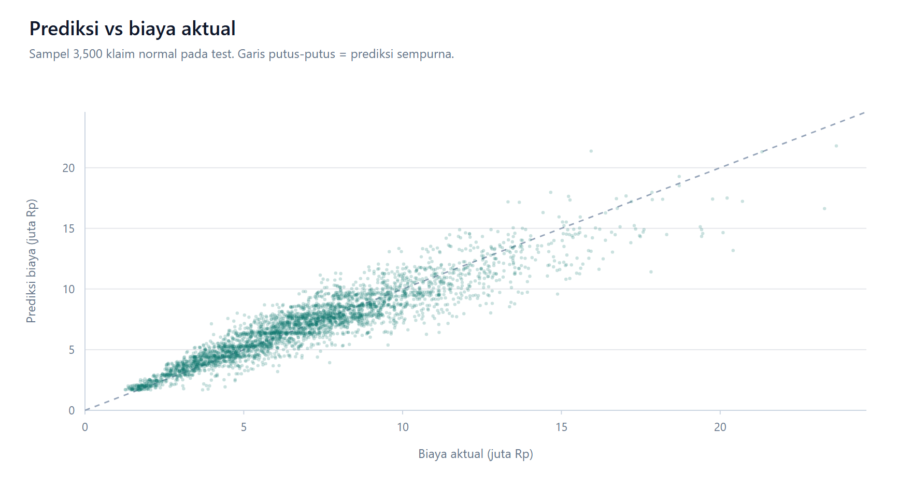
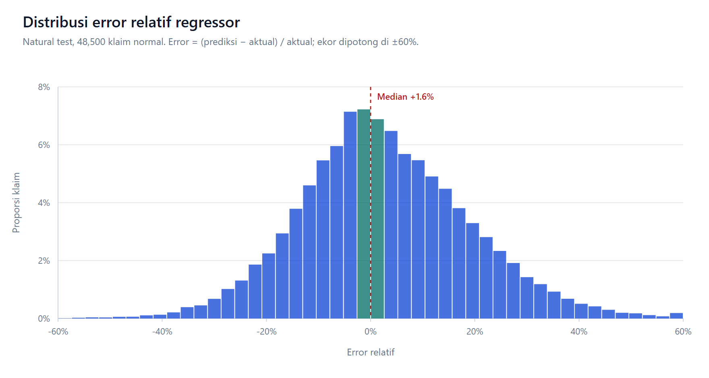
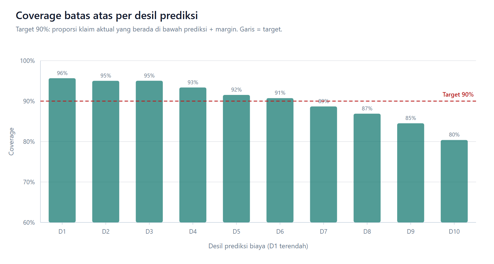

# Synthetic v2 Model Training & Evaluation

> **Synthetic demonstrator only — not BPJS performance validation.**

- Dataset version: `synthetic-v2.4.0-demonstrator`
- Train / validation / test: 150,000 / 50,000 / 50,000
- Seed: `42`
- Config SHA-256: `335e07da7ee44537cdccb9e0cb42d481f704384707ff6862085211d488177855`
- Test set was not used for feature selection or hyperparameter tuning. Aggregate AP group-bootstrap 95% CI: 0.5217–0.5762 (groups=48,437, resamples=100).

## Cost benchmark regressor

- Training rows: normal train claims only
- Validation-only selected ablation: `severity_and_base_rate`
- Test normal n: 48,500
- Test MAPE: 12.830%; MedAE: 641,852.38
- Test MAE: 863,858.85; RMSE: 1,177,733.96; R²: 0.8640
- Upper interval target coverage: 90%; measured: 90.179%

## Supervised classifier candidate (not runtime)

- Test n: 50,000; positive n: 1,500
- Average Precision: 0.5480
- ROC-AUC: 0.8488
- Baseline Average Precision:
  - absolute_benchmark_deviation: 0.1704 (n=50,000, positives=1,500)
  - logistic_regression_rule_flags: 0.1747 (n=50,000, positives=1,500)
  - random: 0.0299 (n=50,000, positives=1,500)

### Operating point (threshold 0.2396, selected on validation)

- Accuracy: 97.9680%; Precision: 80.2500%; Recall: 42.8000%; F1: 0.5583
- Specificity: 99.6742%; Balanced accuracy: 71.2371%; MCC: 0.5775
- Brier score: 0.0180; Log loss: 0.0832; ECE: 0.0039
- Alerts: 800 of 50,000 (1.600%); TP=642, FP=158, TN=48,342, FN=858
- The threshold was fitted on validation only and then frozen for test; test labels never selected it.

### Natural test by anomaly type

- `cloning`: positives=214, AP=0.0039, F1=0.000
- `inflated_bill`: positives=214, AP=0.1403, F1=0.290
- `phantom_billing`: positives=214, AP=0.0323, F1=0.079
- `prolonged_los`: positives=214, AP=0.0639, F1=0.191
- `repeat_billing`: positives=214, AP=0.2175, F1=0.282
- `unbundling`: positives=215, AP=0.6377, F1=0.408
- `upcoding`: positives=215, AP=0.0150, F1=0.016

## OOD stress evaluation

- Overall AP: 0.5037 (n=5,000, positives=150).
- Group-bootstrap AP 95% CI: 0.4125–0.5716 (groups=4,836).

### By anomaly type

- `cloning`: positives=22, AP=0.0044, F1=0.000; group CI 0.002–0.007
- `inflated_bill`: positives=21, AP=0.1215, F1=0.242; group CI 0.054–0.230
- `phantom_billing`: positives=21, AP=0.0297, F1=0.066; group CI 0.016–0.051
- `prolonged_los`: positives=21, AP=0.0815, F1=0.176; group CI 0.037–0.127
- `repeat_billing`: positives=21, AP=0.1293, F1=0.242; group CI 0.057–0.278
- `unbundling`: positives=22, AP=0.7406, F1=0.457; group CI 0.491–0.891
- `upcoding`: positives=22, AP=0.0173, F1=0.022; group CI 0.010–0.036

## Enriched stress evaluation

- Overall AP: 0.8732 (n=2,100, positives=1,050).
- Group-bootstrap AP 95% CI: 0.8586–0.8864 (groups=1,652).

### By anomaly type

- `cloning`: positives=150, AP=0.0474, F1=0.000; group CI 0.042–0.054
- `inflated_bill`: positives=150, AP=0.1634, F1=0.321; group CI 0.134–0.200
- `phantom_billing`: positives=150, AP=0.0934, F1=0.105; group CI 0.075–0.107
- `prolonged_los`: positives=150, AP=0.1142, F1=0.216; group CI 0.090–0.133
- `repeat_billing`: positives=150, AP=0.2608, F1=0.321; group CI 0.199–0.324
- `unbundling`: positives=150, AP=0.6393, F1=0.493; group CI 0.553–0.733
- `upcoding`: positives=150, AP=0.0712, F1=0.024; group CI 0.058–0.087

## Figures

### Distribusi skor model

### Kurva Precision–Recall

### Kurva ROC

### Sapuan ambang keputusan

### Confusion matrix pada ambang terpilih

### Ringkasan metrik klasifikasi

### Average Precision per tipe anomali

### Prediksi vs biaya aktual

### Distribusi error relatif regressor

### Coverage batas atas per desil

## Limitations

- Accuracy is inflated by the synthetic 3% anomaly prevalence; F1, average precision and recall are the primary balanced metrics.
- All claims and labels are synthetic; this does not validate BPJS performance.
- Test set was not used for feature or hyperparameter selection; the classifier threshold was fitted on validation only.
- Precision depends strongly on the synthetic 3% prevalence and is not an operational alert budget.
- Grouped bootstrap intervals are single-seed; multi-seed training/evaluation is still pending.
- Natural-test per-type confidence intervals are reported via the separate enriched and OOD slices, not as natural-prevalence estimates.
