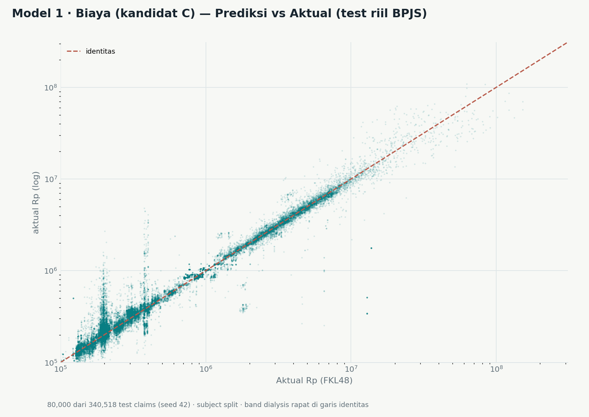
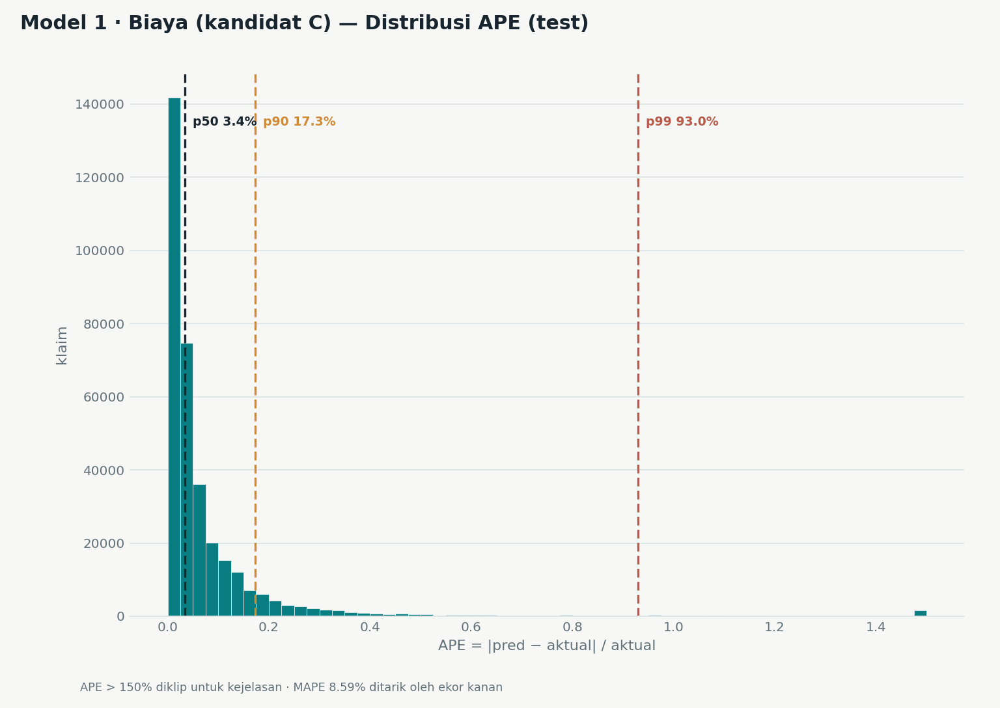
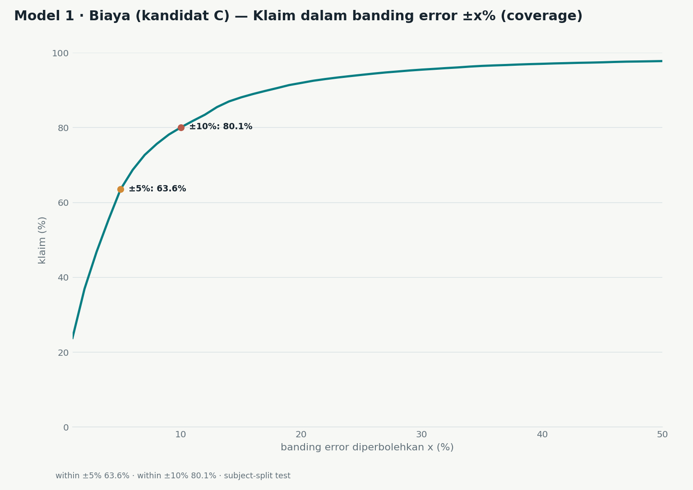
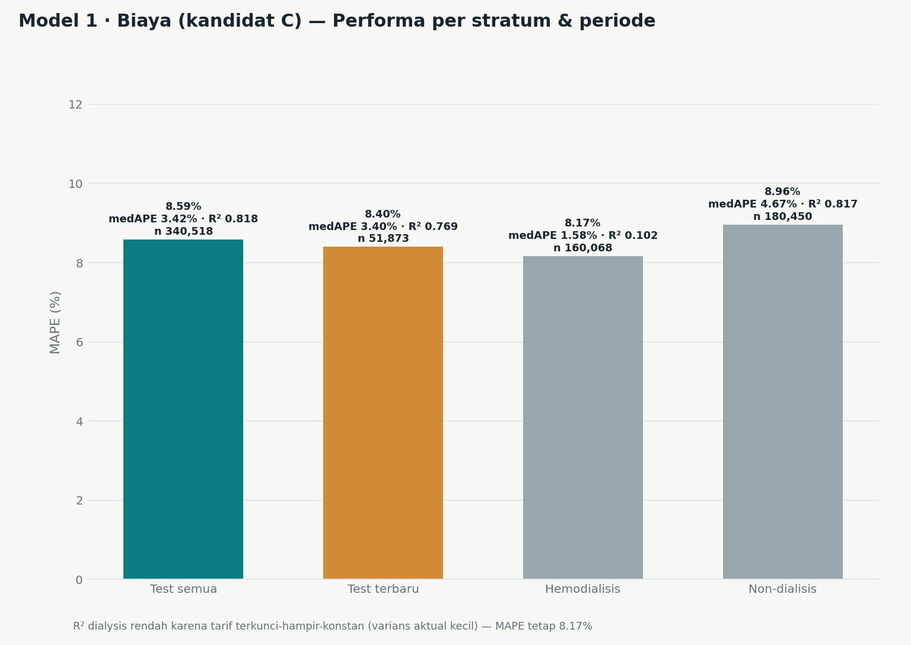
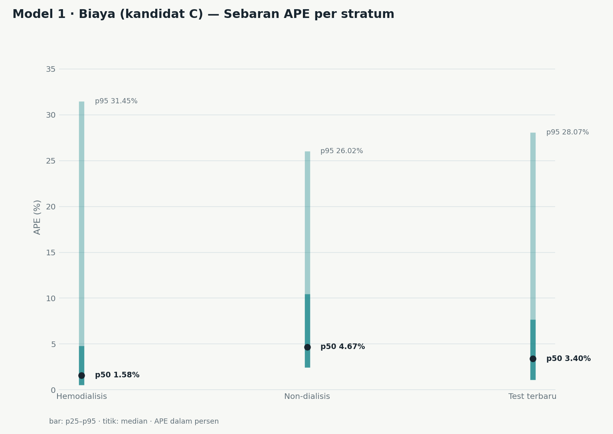
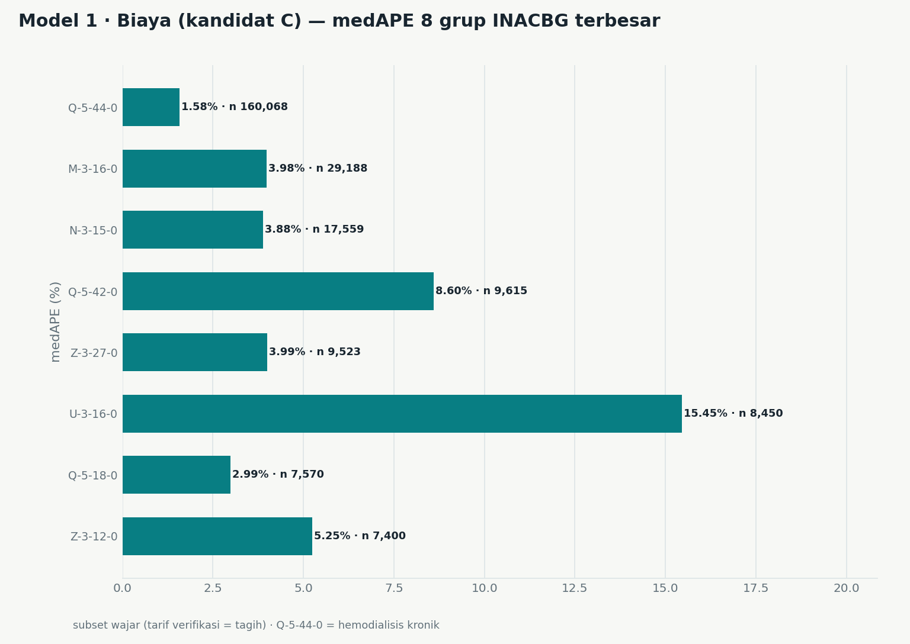
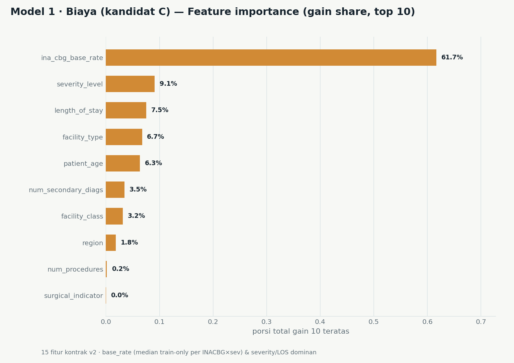
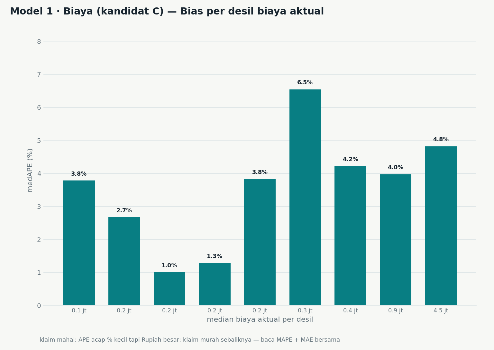

# Model 1 — Regressor Biaya (kandidat C, v2+context)

**Status:** kandidat, bukan runtime (runtime masih LEGACY `backend/models_trained/xgboost_regressor.json`) • **Dibuat:** 2026-10-27 • **Model:** `backend/app/data/analysis/models/xgboost_cost_real_v2_c.json` (ter-ignasi)
**Disiplin:** OFFLINE — retrain pada sampel riil tanpa menyentuh skoring runtime (freeze sampai 1 Nov); promosi hanya lewat gate A3 pasca-1-Nov (`docs/MODELS.md` §2.6, evaluasi per-strata wajib).

Report ini memuat **satu model saja** (kandidat C) — tanpa grafik pembanding. Teks penyebut dalam dokumen: *Model 1*. Tabel eksperimen A/B/C yang memotivasi kandidat tetap ada di `docs/BPJS_RETRAINING_REPORT.md` §2–§4.

## 1. Ringkasan test (BPJS riil, subject-split)

| Item | Nilai |
|---|---|
| Test set | 340.518 klaim FKRTL diterima-penuh (`FKL47 == FKL48 > 0`, LOS 0–365) — split subject `crc32(PSTV01) % 10 ∈ {8,9}`; satu peserta tak pernah lintas train→test |
| MAPE / medAPE | **8,59%** / 3,42% — MAPE ditarik ekor kananjang (lihat Figur 2), tipikal klaim justru jauh lebih akurat |
| MAE / RMSE | Rp 121.822 / Rp 1.340.872 |
| R² | 0.8184 |
| Coverage | dalam ±5% = 63,6% · dalam ±10% = 80,1% |
| Paritas angka | `scripts/bpjs/eval_cost_candidate_c.py` mereplikasi pipeline retrain & menskor ulang model tersimpan — keempat view **identik** `retrain_results.json` (bukti: `eval_cost_c_parity.json`); artefak test 340.518 baris tanpa PII di `eval_cost_c_test.parquet` |

## 2. Per stratum & periode

| View | n | MAPE | medAPE | MAE (Rp) | RMSE (Rp) | R² | ≤5% | ≤10% |
|---|---:|---:|---:|---:|---:|---:|---:|---:|
| Test semua | 340.518 | 8,59% | 3,42% | 121.822 | 1.340.872 | 0.8184 | 63,6% | 80,1% |
| Test terbaru (layanan ≥ 2024-11-06) | 51.873 | 8,40% | 3,40% | 119.423 | 1.509.839 | 0.7694 | 64,0% | 80,3% |
| Hemodialisis (Q-5-44-0) | 160.068 | 8,17% | 1,58% | 34.111 | 410.348 | 0.1019 | 75,9% | 87,0% |
| Non-dialisis | 180.450 | 8,96% | 4,67% | 199.626 | 1.800.952 | 0.8172 | 52,6% | 73,9% |

Catatan R² dialisis yang tampak "rendah" (0.1019): tarif hemodialisis terkunci hampir-konstan sehingga varians aktual kecil — R² memang turun secara matematis, tetapi error rupiah justru paling kecil dari semua view (medAPE 1,58%; MAE Rp 34 ribu). Baca MAPE/MAE bersama R², jangan satu sendiri.

## 3. Provenance 15 fitur kontrak v2

| Kelompok | Fitur | Asal nilai |
|---|---|---|
| Riil (FKRTL + kepesertaan) | length_of_stay, outpatient (= LOS 0), patient_age (tahun layanan − tahun lahir), facility_type & facility_class, region bucket, severity_level, primary_diag_encoded (katalog v2), num_secondary_diags (join 202405) | riil |
| Proxy tarif dari data riil | `ina_cbg_base_rate` = median train-only per (INACBG × severity) — tabel tarif implisit, bukan PMK resmi | turunan riil |
| Konstanta-gap | icu_indicator, ventilator_used, num_medications = 0 (tak tersedia di sampel FKRTL; slot kontrak dipertahankan bernilai 0) | konstanta 0 |

## 4. Set visualisasi (8 figur, satu model, tanpa pembanding)

Semua figur dibuat oleh `scripts/plot_cost_c_report.py` dari artefak eval ber-paritas; setiap judul diawali label **"Model 1 · Biaya (kandidat C)"**.

Figur 1 — Prediksi vs aktual (80.000 titik dari 340.518, seed 42). Pita vertikal di Rp 2–4 juta = kelompok tarif terkunci dialisis:

Figur 2 — Distribusi APE; p50 3,4% / p90 17,3% / p99 93% — ini yang menarik MAPE 8,59%:

Figur 3 — Coverage ±x%:

Figur 4 — MAPE/medAPE/R² per stratum & periode:

Figur 5 — Sebaran APE p25–p95 per stratum:

Figur 6 — medAPE 8 grup INACBG terbesar:

Figur 7 — Feature importance (gain share top 10; base_rate dominan 61,7%):

Figur 8 — Bias per desil biaya aktual (klaim murah: APE % besar; klaim mahal: APE % kecil tapi Rupiah besar):

## 5. Batas & disiplin

- Sumber = sampel BPJS 2025 saja (FKRTL subset wajar 1.697.588 dari 1.699.219 klaim); bukan populasi nasional, bukan data peserta penuh.
- Tiga fitur kontrak bernilai konstanta 0 (ICU/ventilator/obat) — pemisahan komponen menunggu payload A1; sampel tidak punya ID faskes/dokter.
- `ina_cbg_base_rate` = proxy tarif dari median data tren-only; bukan tarif resmi PMK.
- Model kandidat belum dipromosikan; runtime backend masih LEGACY. Keputusan promosi = gate A3 pasca-1-Nov dengan evaluasi per-strata wajib + ablation.
