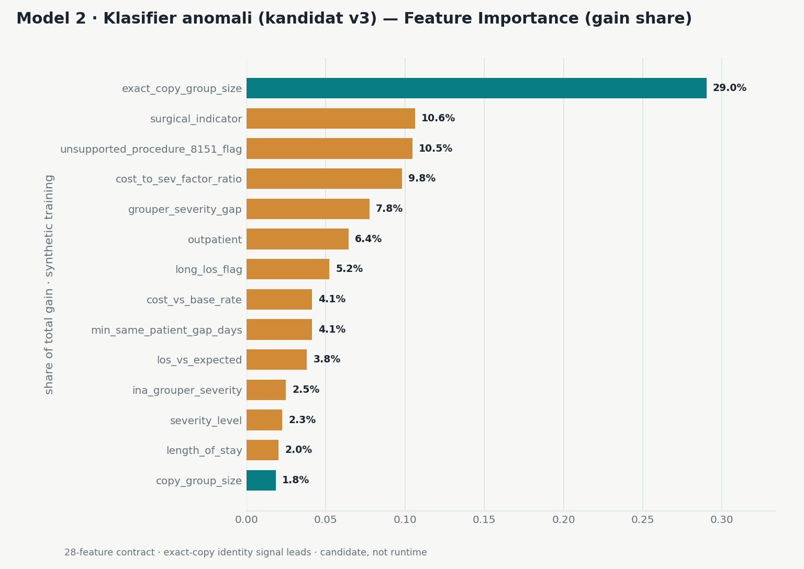
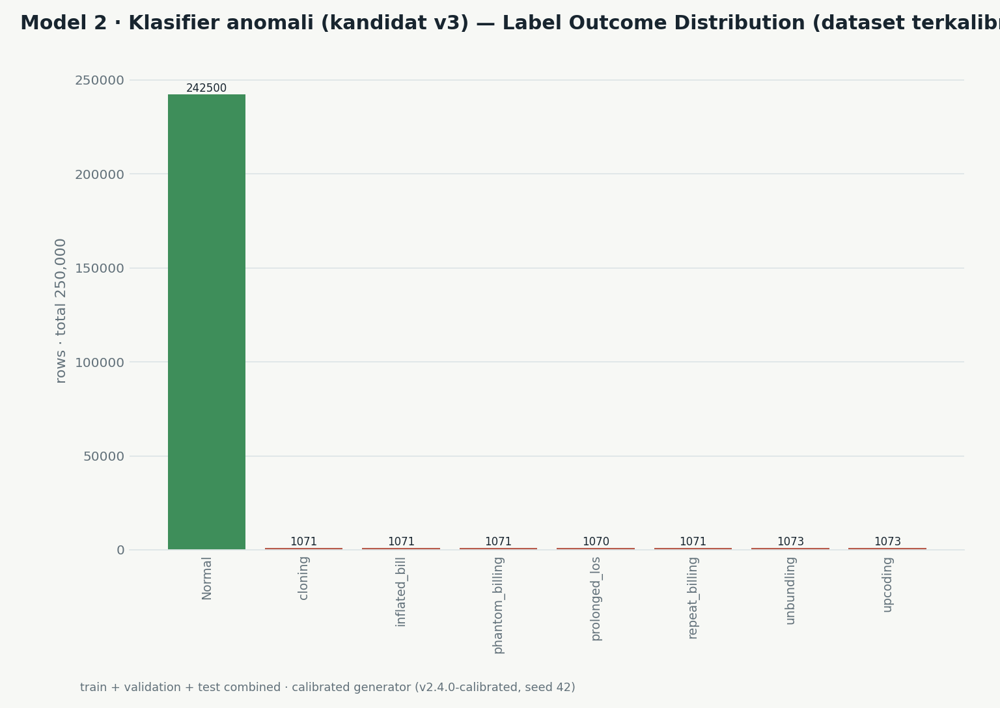
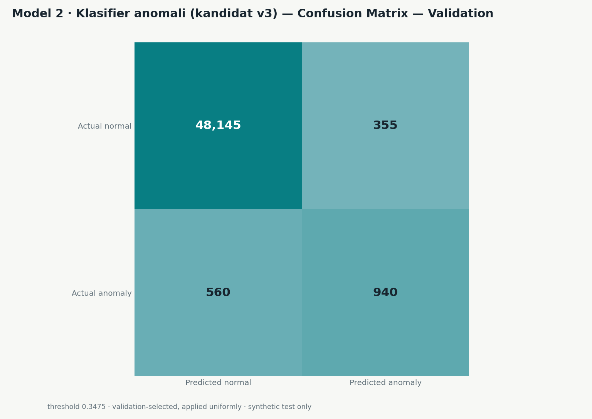
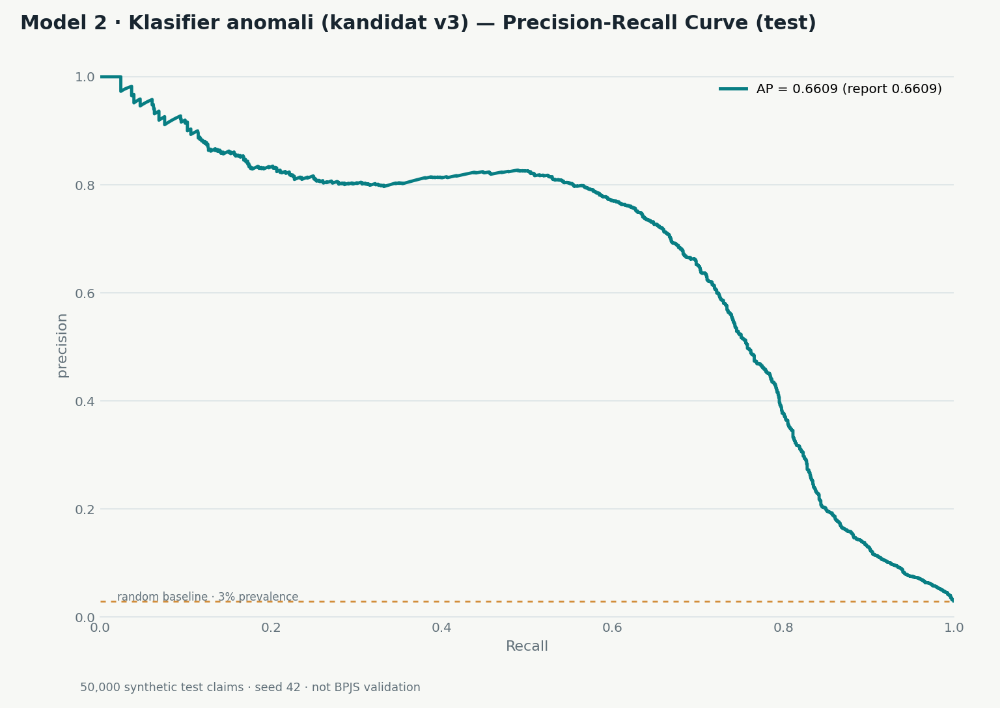
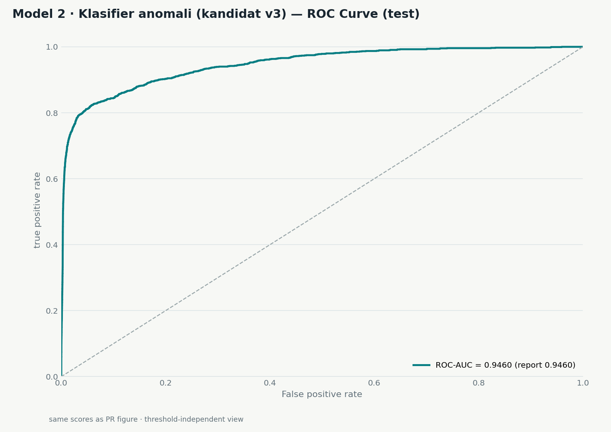
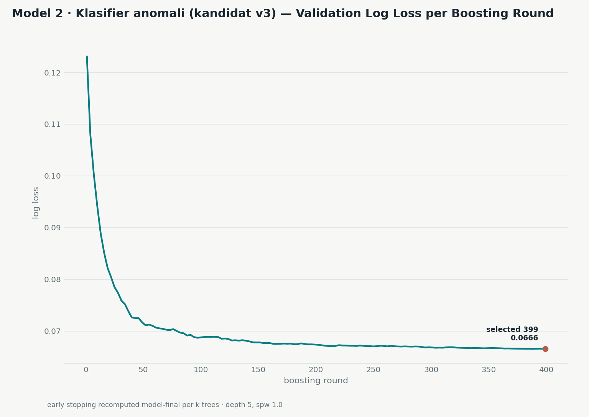

# Model 2 — Klasifier Anomali (kandidat v3, terkalibrasi)

**Status:** kandidat, BUKAN runtime • **Dibuat ulang:** 2026-10-27 • **Model:** `backend/models_trained/synthetic_v2_v3/` • **Dataset:** `data/synthetic_v2_calibrated/` (ter-ignasi)
**Disiplin:** demonstrator sintetis; tidak ada klaim validasi BPJS; promosi hanya lewat gate A3 pasca-1-Nov (`docs/MODELS.md` §2.6, evaluasi per-strata wajib).

Report ini memuat **satu model saja** (klasifier kandidat v3) — tanpa grafik perbandingan antar model. Teks penyebut dalam dokumen: *Model 2* — inilah "fraud model" dalam bahasa sehari-hari: skor klaim normal vs anomali, dilatih dari data sintetis karena sampel BPJS tidak punya label fraud. Setiap angka di bawah dihitung dari model final + dataset yang sama persis dengan training; replay menghasilkan confusion test yang identik dengan angka report (TP/FP/FN/TN sama persis).

## 1. Data & pelatihan

| Item | Nilai |
|---|---|
| Dataset version | `synthetic-v2.4.0-calibrated` |
| Dataset config SHA-256 | `dc4b3ecca4bdb67bf7fdf52d5f0bbd72b75b600d5557d36399e5fac5592e7265` |
| Split train/validation/test | 150.000 / 50.000 / 50.000 (label positif 3%) |
| Seed | 42 |
| Kontrak fitur | 28 (identik kandidat sebelumnya; tanpa fitur baru) |
| Seleksi (validation saja) | depth 5 · scale_pos_weight 1.0 · iteration 399 → validation AP 0.6399 |
| Test set | tidak dipakai untuk seleksi fitur/hyperparameter/ambang |

Dataset kandidat dibuat generator v2 jalur `--calibrated` (marginals L8/L9: repeat-mechanism bucket, cadence hard-negative dialisis, derau biaya campuran terkunci-tarif 47% + invers-CDF kuantil). Maksud kalibrasi: dunia latihan yang lebih realistis — bukan penurunan kualitas.

## 2. Metrik test (headline)

| Metrik | Nilai |
|---|---|
| Average Precision | **0.6609** (CI95 group-bootstrap [0.6350, 0.6833]; groups=48.464, replicates=100) |
| ROC-AUC | 0.9460 |
| Log loss | 0.06441 |
| Brier / ECE | 0.01476 / 0.00388 |
| Prevalence test | 3.0% (1.500 dari 50.000) |

## 3. Operating point (ambang dari validation, dipakai seragam)

Ambang **0.3475** dipilih di validation, lalu dibekukan dan diterapkan seragam ke train/validation/test — label test tidak pernah memilih ambang.

| Metrik | Nilai |
|---|---|
| Alerts | 1.342 dari 50.000 (2.684%) |
| Precision / Recall | 72.73% / 65.07% (F1 0.6868) |
| Accuracy / Balanced acc | 98.22% / 82.16% |
| MCC / Specificity | 0.6788 / 99.25% (FPR 0.755%) |
| Confusion test (replay = report) | TP 976 · FP 366 · FN 524 · TN 48.134 |

## 4. Per tipe anomali (test, ambang yang sama)

| Tipe | Positives | AP | Recall @ 0.3475 |
|---|---:|---:|---:|
| unbundling | 215 | 0.1506 | 0.944 |
| upcoding | 215 | 0.1691 | 0.726 |
| phantom_billing | 214 | 0.1504 | 0.776 |
| repeat_billing | 214 | 0.2142 | 0.636 |
| inflated_bill | 214 | 0.0529 | 0.505 |
| cloning | 214 | 0.0680 | 0.500 |
| prolonged_los | 214 | 0.0452 | 0.467 |

Recall sekarang tersebar lebih merata antar tipe (tidak ada tipe yang praktis buta), namun AP untuk `prolonged_los` dan `inflated_bill` tetap lemah — masih di backlog pengembangan fitur.

## 5. Stress view (bukan test natural)

| View | n | Positives | AP |
|---|---:|---:|---:|
| Enriched stress | 2.100 | 1.050 | 0.8500 |
| OOD | 5.000 | 150 | 0.6319 |

OOD tetap ditahan oleh hard-negative desain (duplikat legal & readmisi legit yang berbagi pola relasional dengan cloning/repeat) — batas struktural generator, bukan kegagalan model.

## 6. Set visualisasi (8 figur, satu model, tanpa pembanding)

Semua figur diregenerasi oleh `scripts/plot_classifier_v3_report.py` dari model final + dataset training yang sama (replay deterministik); setiap judul diawali label **"Model 2 · Klasifier anomali (kandidat v3)"**.

### 6.1 Feature importance (gain share, 14 teratas)

Sinyal identitas salinan dominan (`exact_copy_group_size` 29% gain share dari 14 teratas) — konsisten dengan mekanisme cloning sebagai pola paling mudah dipisahkan.

### 6.2 Distribusi label outcome (train+val+test)

### 6.3–6.5 Confusion matrix (train / validation / test) pada ambang 0.3475

### 6.6 Precision–recall curve (test)

### 6.7 ROC curve (test)

### 6.8 Validation log loss per boosting round

## 7. Batas & disiplin

- **Semua klaim + label sintetis.** Tidak ada validasi fraud pada klaim BPJS riil; sampel BPJS tidak punya label fraud (lihat `docs/BPJS_SAMPLE_PROFILING.md`).
- Precision sangat sensitif terhadap prevalence sintetis 3%; angka precision bukan anggaran alert operasional.
- Fitur relasional (duplicate group, gap pasien, expected-LOS benchmark) dihitung per split dataset; scorer runtime tidak memakainya.
- Single seed; evaluasi multi-seed menyusul via `docs/MODELS.md` jalur multiseed.
- Perubahan AP v2.4 → v3 dibaca sebagai dunia latihan yang lebih realistis (kalibrasi L8/L9 masuk), bukan indikasi degradasi — narasi lengkap di `docs/BPJS_SYNTH_CALIBRATION_REPORT.md`.
- Promosi runtime melalui gate A3 pasca-1-Nov dengan evaluasi per-strata wajib; sampai saat itu model ini hanya artefak kandidat — dan penolakan di gate pun kemungkinan yang jujur (tak ada label riil untuk memvalidasi).
